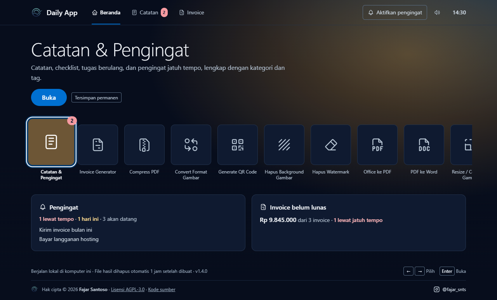
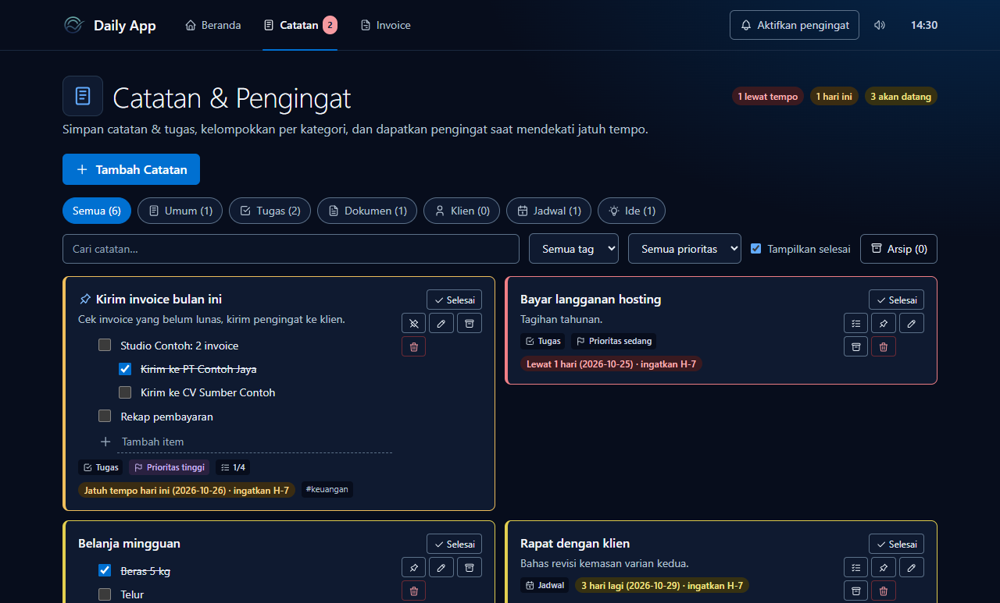
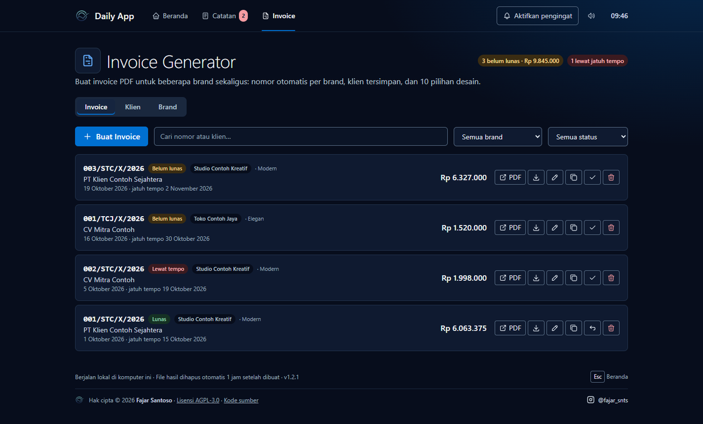
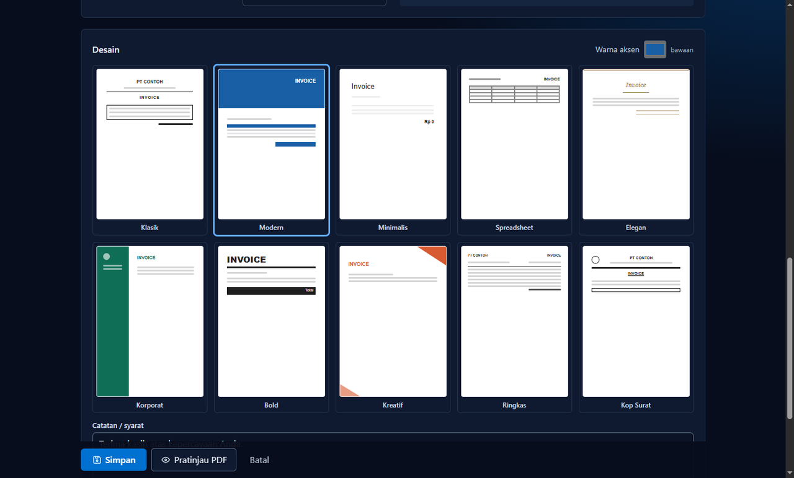
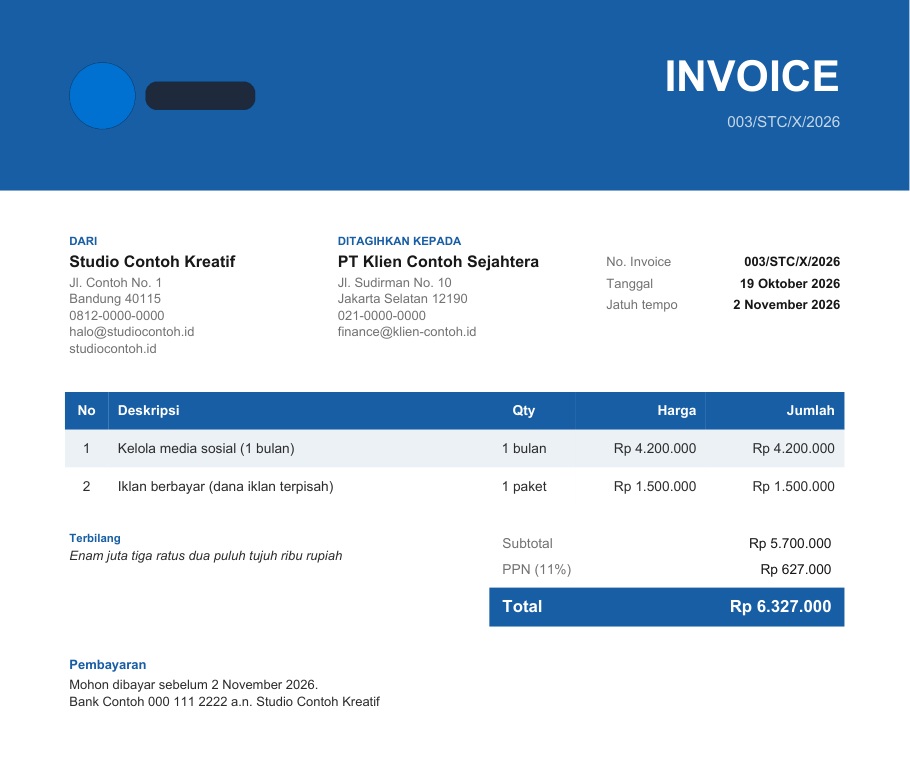

<p align="center">
  
</p>

<h1 align="center">Daily App</h1>

<p align="center">
  Kumpulan alat kerja harian untuk Windows: PDF, gambar, invoice, dan catatan.<br>
  Gratis, dan semua file diproses di laptop Anda sendiri.
</p>

<p align="center">
  <!-- Ganti LINK_GOOGLE_DRIVE dengan link berbagi folder/file installer di Google Drive. -->
  <a href="LINK_GOOGLE_DRIVE"><b>Unduh Daily App 1.3.0 untuk Windows</b></a>
  ·
  <a href="#cara-memasang">Cara memasang</a>
  ·
  <a href="https://www.instagram.com/fajar_snts">Instagram @fajar_snts</a>
</p>



## Isinya

Pilih alat dari Beranda dengan mouse, atau tombol panah lalu **Enter**. Tombol **Esc** kembali
ke Beranda.

| Alat | Fungsi |
|---|---|
| PDF ke Word | Ubah `.pdf` menjadi `.docx` yang bisa diedit |
| Office ke PDF | Word, Excel, PowerPoint menjadi PDF |
| Kompres PDF | Perkecil ukuran PDF; metode Maksimal mengompres ulang gambar |
| Ubah ukuran gambar | Skala, lebar/tinggi, atau target ukuran file (KB) |
| Konversi gambar | PNG, JPG, JFIF, WEBP, HEIC, BMP, TIFF |
| Hapus background | Latar belakang foto dihapus otomatis (AI) |
| Hapus watermark | Sapukan kuas di atas watermark, lalu hapus (OpenCV atau LaMa AI) |
| QR code | Teks atau URL menjadi gambar QR |
| Catatan & pengingat | Catatan, tugas, tenggat, dan pengingat jatuh tempo |
| Sticky note | Seret kartu catatan keluar jendela untuk menempelkannya di desktop |
| Invoice | Invoice PDF untuk beberapa brand: 10 desain, nomor otomatis, klien tersimpan, PPN & diskon, terbilang |

Banyak alat menerima beberapa file sekaligus; hasilnya diunduh sebagai satu `.zip`.

Installer sudah menyertakan semua yang dibutuhkan: konverter dokumen (LibreOffice),
Ghostscript, dan model AI. Setelah dipasang, tidak ada yang perlu diunduh lagi dan semua
alat bisa dipakai tanpa internet.

<table>
  <tr>
    <td width="50%"></td>
    <td width="50%"></td>
  </tr>
  <tr>
    <td></td>
    <td></td>
  </tr>
</table>

<sub>Tangkapan layar memakai data contoh.</sub>

## Cara memasang

1. Unduh `DailyApp-Setup-1.3.0.exe` dari link di atas (sekitar 615 MB, karena semua komponen
   sudah termasuk).
2. Jalankan. Bila muncul layar **"Windows protected your PC"**, klik **More info**, lalu
   **Run anyway**. Peringatan ini muncul karena aplikasi belum ditandatangani sertifikat
   berbayar.
3. Ikuti langkah instalasi (tidak perlu hak admin), lalu buka **Daily App** dari Desktop atau
   Start Menu.

**Persyaratan:**
- Windows 10/11 64-bit.
- Ruang kosong sekitar 2 GB saat instalasi (1,4 GB setelah terpasang).
- RAM 4 GB; 8 GB disarankan untuk Hapus Background dan Hapus Watermark LaMa.
- Daily App tampil sebagai jendela aplikasi memakai Microsoft Edge WebView2 (sudah ada di
  Windows 11 dan sebagian besar Windows 10).

**Memeriksa keaslian file (opsional):** SHA-256 `DailyApp-Setup-1.3.0.exe`:

```
f92cfd7dfeeba21fad8869cfde32103a6b644853d03401fed897c497d8128227
```

Cek di PowerShell:

```powershell
Get-FileHash .\DailyApp-Setup-1.3.0.exe -Algorithm SHA256
```

## Privasi & data

- File yang Anda proses tidak diunggah ke server mana pun; semuanya diproses di komputer Anda.
- Catatan, brand, klien, dan invoice tersimpan di `%LOCALAPPDATA%\DailyApp` dan tidak terhapus
  saat aplikasi diperbarui atau di-uninstall. Untuk backup, salin folder `data` di dalamnya.
- File hasil di dalam aplikasi dihapus otomatis 1 jam setelah dibuat.
- Tidak butuh internet: model AI, LibreOffice, dan Ghostscript ikut terpasang.

## Bila ada masalah

- **Office ke PDF berlabel *perlu setup*, atau Kompres PDF Maksimal gagal dengan pesan
  "Komponen Ghostscript tidak ditemukan":** komponen bawaannya terhapus atau rusak. Pasang ulang
  Daily App dari installer terbaru.
- **Hapus Watermark LaMa lama sekali:** model AI sedang dimuat (1–2 menit di laptop lama), yaitu
  saat pertama dipakai dan setelah 10 menit tidak dipakai. Selama model masih dimuat, proses
  berikutnya lebih cepat.
- **Proses pertama sangat lambat, atau gagal lalu berhasil saat diulang:** antivirus (mis.
  Avast/AVG) sedang memindai berkas aplikasi yang baru dipasang, termasuk model AI. Pada
  pengujian, Hapus Background pertama setelah instalasi butuh 2–3 menit; berikutnya sekitar
  10 detik. Bila gagal, klik **Proses** sekali lagi.
- **Aplikasi tidak mau terbuka:** kirim berkas log dari `%LOCALAPPDATA%\DailyApp\logs` lewat
  DM Instagram [@fajar_snts](https://www.instagram.com/fajar_snts).

## Untuk pengembang

Menjalankan dari kode sumber, menambah alat baru, dan membuat installer:
[docs/PENGEMBANG.md](docs/PENGEMBANG.md). Arah desain tampilan: [DESIGN.md](DESIGN.md).

## Hak cipta & lisensi

Hak cipta © 2026 **Fajar Santoso** · [Instagram @fajar_snts](https://www.instagram.com/fajar_snts)

Daily App adalah perangkat lunak bebas dengan lisensi **GNU AGPL-3.0** ([LICENSE](LICENSE)).
Anda boleh memakai, membagikan, dan mengubahnya; bila membagikan ulang, sertakan pemberitahuan
hak cipta dan kode sumbernya. Daftar komponen pihak ketiga ada di [NOTICE.md](NOTICE.md).

"PlayStation" adalah merek dagang Sony Interactive Entertainment. Daily App hanya terinspirasi
tata letak layar berandanya dan tidak berafiliasi dengan Sony.
